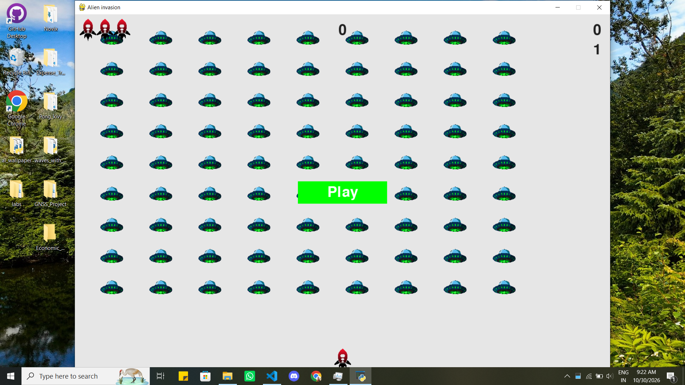

# Alien Invasion

A simple arcade-style game built with Python and Pygame. Move your ship, shoot
the alien fleet, and try to get the highest score.

## Demo



## Requirements

- Python 3.9 or newer
- pip

## Run on Windows

Open PowerShell in the repository folder and run:

```powershell
py -m venv .venv
.\.venv\Scripts\python.exe -m pip install -r requirements.txt
.\.venv\Scripts\python.exe .\project\alien_invasion.py
```

Run the game command from the repository folder so it can find the images in
`project\images`.

## Controls

- **Left/Right arrow keys**: Move the ship
- **Space**: Fire
- **Q**: Quit
- Click **Play** to start or restart the game
